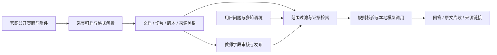

# 校园知识服务 Agent 智能体平台

基于 **Python / FastAPI / SQLAlchemy / Ollama / Qwen3** 搭建的校园知识服务应用，围绕公开通知、竞赛、学籍及办事资料，实现从资料采集、附件解析到检索问答、证据溯源与人工审核的完整业务链路。

项目采用 **RAG（Retrieval-Augmented Generation，检索增强生成）** 和证据约束工作流：先限定事项、年度及可见范围，再检索原文、组织回答并返回来源。这里的 Agent 指知识服务工作流；当前实现以检索、规则校验和模型调用协作为主。

**在线演示：** [zlyb.cloud](https://zlyb.cloud)（私人测试入口，需登录，依赖本机服务在线）。

## 业务问题与解决方案

| 业务问题 | 实现方案 | 主要代码 |
|---|---|---|
| 官网通知分散、附件格式不一致 | 公开站点归档、附件关联、PDF / Word / 表格解析与本地 OCR | [`school_archive.py`](app/school_archive.py)、[`ingest.py`](app/ingest.py) |
| 相似政策跨年度混用 | 年份、学期、版本及文档身份约束；区分发布日与适用年度 | [`semester.py`](app/semester.py)、[`source_versions.py`](app/source_versions.py) |
| 模型回答缺少可复核依据 | 原文证据窗口、选证核验、出处定位与版本提示 | [`evidence_windows.py`](app/evidence_windows.py)、[`model_evidence.py`](app/model_evidence.py) |
| 追问丢失事项或条件 | 有界多轮语境、话题切换、年份与条件继承 | [`conversation.py`](app/conversation.py)、[`campus_qa.py`](app/campus_qa.py) |
| 候选字段被误当正式政策 | Human-in-the-loop：字段核对、待核实状态、审核发布与撤回 | [`main.py`](app/main.py)、[`model.py`](app/model.py) |
| 重复通知与中断处理 | 重复通知归并、来源关系保留、解析诊断与恢复工具 | [`duplicate_notices.py`](app/duplicate_notices.py)、[`parse_diagnostics.py`](app/parse_diagnostics.py) |

## 系统架构



- **API 与应用层：** FastAPI 提供问答、资料筛选、解析和管理入口；SQLAlchemy 管理文档、切片、赛事与审核状态。展示副本默认 SQLite，开发环境也实际使用过 PostgreSQL。
- **知识处理层：** 保留页面与附件的父子关系、内容位置、日期及版本；PDF 表格与 OCR 采用专门解析逻辑，避免只以扁平文本解释结构化资料。
- **检索与生成层：** 关键词、标题权重、文档范围及年度过滤共同参与召回；受限赛事范围可结合已有向量。全库语义索引属于可选试验能力，`CAMPUS_SEMANTIC_SEARCH` 默认关闭，不能据此宣称全库已完成向量化。
- **证据治理层：** 通过 Evidence Grounding（证据约束）、Provenance（来源追踪）与 Temporal Scoping（时间范围限定），处理无依据补全、旧政策误用和来源失效问题。多轮历史只帮助理解问题，不作为政策证据。
- **联网补充：** 公开搜索与官方目录发现并行处理，读取匹配事项的官方正文；有界 TTL 缓存与同键并发合并减少重复访问，返回前仍检查资料公开状态和来源关系。

## 技术栈与工程设计

| 层次 | 技术与职责 |
|---|---|
| 服务端 | Python、FastAPI、Uvicorn、SQLAlchemy、HTTPX |
| 文档处理 | pypdf、pdfplumber、python-docx、OpenPyXL、RapidOCR |
| 模型运行 | Ollama、Qwen3、本地生成及嵌入接口 |
| 数据持久化 | SQLite 默认演示库；PostgreSQL 开发与恢复验证 |
| 交互层 | 原生 HTML / CSS / JavaScript，学生问答与教师管理页面 |
| 运维实践 | 解析恢复、来源核验、备份恢复；私人测试采用 Nginx / HTTPS 与受限 SSH 隧道 |

Dify / Docker 属于原开发环境已有集成实践；本仓库不打包 Dify 全栈、生产数据或个人网关配置。公网入口连接本机应用，模型和业务库仍依赖电脑在线。

## 本地运行

以下命令为 **Windows PowerShell**，在项目根目录执行。开发环境使用 Python 3.12；需可用的 Ollama 及相应模型资源。

```powershell
python -m venv .venv
.\.venv\Scripts\Activate.ps1
pip install -r requirements.txt
ollama pull qwen3:8b
python -m uvicorn app.main:app --host 127.0.0.1 --port 8008
```

打开 `http://127.0.0.1:8008`。首次启动为空库，需自行导入公开资料；管理端随机口令首次生成于 `.secrets/admin-password.txt`，仅在本机读取。受限语义检索需另行准备 `qwen3-embedding:0.6b` 及对应索引。

| 环境变量 | 作用 |
|---|---|
| `CAMPUS_DATA` | 独立数据目录 |
| `DATABASE_URL` | SQLAlchemy 数据库连接，未配置时使用本地 SQLite |
| `OLLAMA_URL` | Ollama 服务地址，默认本机 11434 |
| `CHAT_MODEL` / `EMBED_MODEL` | 生成模型与嵌入模型名称 |
| `CAMPUS_SEMANTIC_SEARCH` | 全库语义索引试验开关，默认 `0` |

## 验证、数据范围与项目状态

2026-10-15 核对时，本仓库发布范围内的应用、测试与工具代码已与当前主工作目录一致。源码同步清单见 [`SOURCE_INVENTORY.json`](SOURCE_INVENTORY.json)，检查说明见 [`VALIDATION.md`](VALIDATION.md)。

证据逻辑可在独立数据库与临时目录中运行：

```powershell
python -m pytest tests/test_model_evidence.py tests/test_evidence_windows.py -q
```

历史检索与数据库恢复记录保留在 [`validation/historical-summary.json`](validation/historical-summary.json)，标明日期、统计口径与原报告哈希。开发回归、检索召回和有限来源核对不等于总体回答准确率。

当前仓库可用于代码审阅和独立部署验证。公开待审核资料不等于教师认定的正式政策；项目不是学校官方服务，未接入学校统一身份认证。数据库、官网原件归档、模型权重、账号口令和个人服务器配置不随源码发布。
